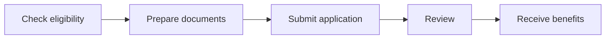

# Contributing

Thanks for helping keep this directory current.

## Source and quality rules

1. Use a **primary official source** only: the provider, official fund, or official government site.
2. Open the application/source link and confirm it is reachable before submitting a change.
3. Do not infer deadlines, funding amounts, documents, or eligibility. Write **Not published** or **Unverified** instead.
4. Active entries must have a current application route. Move expired, closed, or insufficiently documented entries to `archive/`.
5. Keep the README master table, the category detail page, and `programs.csv` synchronized.
6. Update **Last verified** whenever a row changes.

## Required entry fields

Each entry needs: program, provider, region, type, short benefits, company stage, location restrictions, required documents, funding/revenue limits, prerequisites, deadline/status, official apply link, last verified date, benefits list, numbered application roadmap, and estimated timeline.

## Status badges

Use exactly one: ✅ Open · 🔄 Rolling · ⏳ Opens soon · ❌ Closed. Closed and unverified items belong in `archive/`, not the active master table.

## Entry template

```markdown
<a id="program-slug"></a>

<details>
<summary><strong>🔄 Rolling Program Name</strong> — Provider</summary>

**Apply:** [Official application page](OFFICIAL_URL)  
**Last verified:** YYYY-MM-DD

### Eligibility at a glance

| Requirement | Officially stated detail |
|---|---|
| Company stage | Not published |
| Location / restrictions | Not published |
| Documents | Not published |
| Funding / revenue limits | Not published |
| Prerequisites | Not published |

### Benefits

- Benefit supported by the official source.

### How to apply

1. Check eligibility.
2. Prepare the documents stated by the official source.
3. Submit the application.
4. Complete review or interview if stated.
5. Receive benefits if selected.



**Estimated timeline:** Not published.

</details>
```


## Coupon fields

Every program row should include a coupon assessment:

| Field | Allowed meaning |
|---|---|
| `coupon_status` | `Official code available`, `No public code verified`, or `Unverified third-party code` |
| `coupon_code` | Exact provider-published code, or `Not published` |
| `coupon_source` | Official provider page that publishes or explains the code |
| `coupon_last_verified` | Date the code or absence of a public code was checked |
| `community_signal` | A lead only; never evidence that a code is valid |

Reddit and Telegram links belong in `communities/README.md`. Public communities are discovery sources only. Never list a code as active based solely on a community post, affiliate page, or forwarded Telegram message.
