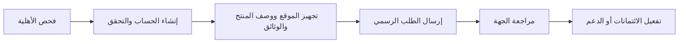

# الدفعة السادسة — الصين

تاريخ التحقق: **2026-10-13**

> تحتوي هذه الدفعة على برامج صينية موثقة من صفحات رسمية، بالإضافة إلى فهرس منفصل من 200 جهة حاضنة واردة في سجل رسمي لمدينة Shenzhen. لا تُحتسب الجهات الموجودة في الفهرس كبرامج مؤكدة حتى يتم التحقق من صفحة كل جهة وشروطها.

## برامج موثقة

| الحالة | البرنامج | الجهة | النوع | الفوائد | الأهلية والمتطلبات | الموعد / حالة 2026–2027 | رابط التقديم أو المصدر | آخر تحقق |
|---|---|---|---|---|---|---|---|---|
| 🔄 Rolling | Alibaba Cloud Startup Catalyst | Alibaba Cloud | ائتمانات سحابية | ائتمانات سحابية للشركات الممولة؛ المبلغ النهائي تحدده المراجعة | شركة ناشئة ممولة، تأسست خلال آخر 10 سنوات، موقع فعال وبريد شركة | التقديم مستمر؛ المراجعة عادة خلال 5–7 أيام عمل | [التقديم الرسمي](https://www.alibabacloud.com/en/startup/cloudcreditredemption?_p_lc=1) | 2026-10-13 |
| 🔄 Rolling | Alibaba Cloud AI Catalyst | Alibaba Cloud | ائتمانات / تسريع | حتى 120,000 دولار ائتمانات، رموز Model Studio، دعم فني وساعات استشارة | شركات الذكاء الاصطناعي وبناة التطبيقات والنماذج؛ القبول حسب الطلب | مستمر؛ لا يوجد موعد 2026/2027 منشور | [البرنامج الرسمي](https://www.alibabacloud.com/en/startup/ai?_p_lc=1) | 2026-10-13 |
| 🔄 Rolling | Tencent Cloud Startup Program | Tencent Cloud | ائتمانات / خصومات / دعم | دعم مالي، خصومات خدمات، تدريب وفرص تسويق | شركة مدعومة من VC؛ نموذج الطلب يطلب تاريخ التأسيس، الموقع، وصف المنتج، مرحلة التمويل، وثيقة تمويل VC وفاتورة سحابية سابقة | معالجة الطلب خلال أسبوعين؛ لا يوجد موعد سنوي منشور | [صفحة التقديم الرسمية](https://www.tencentcloud.com/campaign/startupprogram) | 2026-10-13 |
| ⚠️ Unverified | Baidu AI Star Plan | Baidu Intelligent Cloud | ائتمانات / دعم AI / ربط استثماري | الصفحة الرسمية تذكر قيمة إجمالية قدرها 100 مليون RMB، وحزمًا حسابية بقيمة 5,000 RMB، وفرص ترويج وربط رأسمالي | مستخدمون أفراد أو شركات بعد تسجيل Baidu Cloud والتحقق الحقيقي وتقديم وصف منتج AI حالي أو مخطط | الصفحة لا تعرض موعد 2026/2027 واضحًا؛ تعامل كغير مؤكد حتى تأكيد فتح التقديم | [الصفحة الرسمية الصينية](https://cloud.baidu.com/event/aiStarPlan/index.html) | 2026-10-13 |
| 🔄 Rolling | Huawei Cloud Startup Program | Huawei Cloud | ائتمانات / تمكين / تسريع | قسيمة ائتمان نقدي لا تقل عن 5,000 دولار، وإمكانية التقديم حتى 150,000 دولار، وترحيل سحابي وموارد أعمال | مؤسسة تأسست منذ أقل من 5 سنوات، غير مدرجة، ولا تتجاوز ملكية الشركات المدرجة 50%؛ حساب Huawei Cloud وتحقق حقيقي | التقديم مستمر؛ لا يوجد موعد سنوي منشور | [البرنامج الرسمي](https://startup.huaweicloud.com/intl/en-us/index.html) | 2026-10-13 |
| ❌ Closed / historical | China Innovation and Entrepreneurship Competition — 12th edition | Ministry of Science and Technology and partners | مسابقة / ربط تمويلي | تأهل للمراحل الوطنية، عرض أمام مستثمرين، ترشيح لصناديق وطنية ودعم بنكي وشراكات | في النسخة المنشورة: شركة غير مدرجة، ملكية فكرية، إيراد 2022 لا يتجاوز 200 مليون RMB، وشروط عمر حسب مجموعة المسابقة | الموعد المنشور يخص 2023؛ لا يُفترض أنه مفتوح في 2026 أو 2027 | [الإعلان الرسمي](https://www.most.gov.cn/xxgk/xinxifenlei/fdzdgknr/qtwj/qtwj2023/202303/t20230323_185191.html) | 2026-10-13 |

## مسار التقديم العام

## فهرس 200 جهة حاضنة — مرشح للتحقق الفردي

أصدرت **Shenzhen Municipal Science and Technology Innovation Commission** قائمة رسمية لحاضنات ومراكز ابتكار، وتتضمن أكثر من 300 جهة. أُدرجت 200 جهة في ملف CSV منفصل مع الرابط الحكومي نفسه. هذه الجهات ليست برامج مؤكدة بعد؛ لم تُخمن فوائدها أو مواعيدها.

- [فهرس 200 جهة مرشحة](../../imports/batch-06-china/shenzhen-incubator-candidates.csv)
- [المصدر الحكومي للقائمة](https://stic.sz.gov.cn/kjfw/cxzt/kjqyfhqmd/)

### قاعدة الإدراج

لا تُنقل جهة من الفهرس المرشح إلى القائمة المؤكدة إلا بعد العثور على صفحة رسمية خاصة بها تثبت برنامجًا أو خدمة احتضان، ثم تسجيل النوع، الفوائد، الأهلية، حالة التقديم، والرابط وتاريخ التحقق.
