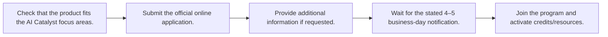
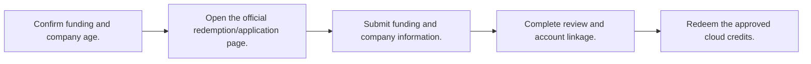
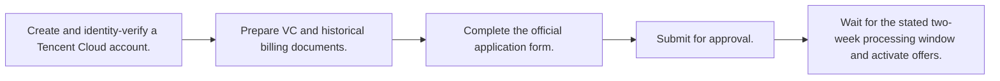
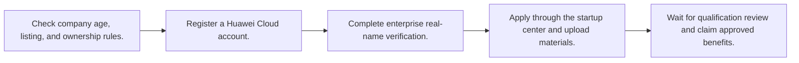

# 🇨🇳 China — Cloud and AI Programs

Last reviewed: **2026-10-12**

Legend: ✅ Open · 🔄 Rolling · ⏳ Opens soon · ❌ Closed

## Apply-ready index

| Program | Provider | Official link | Type | Benefits | Eligibility | Deadline / status | Last verified |
|---|---|---|---|---|---|---|---|
| [Alibaba Cloud AI Catalyst Program](#alibaba-ai-catalyst) | Alibaba Cloud | [Apply](https://www.alibabacloud.com/en/startup/ai?_p_lc=1) | Credits / accelerator | 2B Model Studio tokens and up to $120,000 cloud credits | Online application; official page especially targets AI video/image creation, model aggregators, and content moderation. Further eligibility is assessed during review. | 🔄 Rolling — no 2026/2027 deadline published | 2026-10-12 |
| [Alibaba Cloud Startup Catalyst Program](#alibaba-startup-catalyst) | Alibaba Cloud | [Apply](https://www.alibabacloud.com/en/startup/cloudcreditredemption?_p_lc=1) | Credits | Cloud credits for funded startups | Funded startup founded within the last 10 years; full current tier is confirmed in the application flow. | 🔄 Rolling — no 2026/2027 deadline published | 2026-10-12 |
| [Tencent Cloud Startup Program](#tencent-cloud-startup) | Tencent Cloud | [Apply](https://www.tencentcloud.com/campaign/startupprogram) | Credits / discount / accelerator | Financial support, discounts, training, and marketing opportunities | Designed for VC-backed startups; application requests incorporation, financing stage, VC document, historical cloud billing, product interest, and usage information. | 🔄 Rolling — applications processed within two weeks | 2026-10-12 |
| [Huawei Cloud Startup Program](#huawei-cloud-startup) | Huawei Cloud | [Apply](https://startup.huaweicloud.com/intl/en-us/index.html) | Credits / accelerator | $5,000 minimum voucher; possible application up to $150,000 | Enterprise established less than 5 years; not listed; no more than 50% of shares held by a listed company; enterprise real-name verification. | 🔄 Rolling — no 2026/2027 deadline published | 2026-10-12 |

## Eligibility, benefits, and application roadmaps

<strong>🔄 Rolling Alibaba Cloud AI Catalyst Program</strong> — Alibaba Cloud

**Apply:** [https://www.alibabacloud.com/en/startup/ai?_p_lc=1](https://www.alibabacloud.com/en/startup/ai?_p_lc=1)  
**Last verified:** 2026-10-12

### Eligibility at a glance

| Requirement | Officially stated detail |
|---|---|
| Company stage | AI startups and model/application builders. |
| Location / restrictions | Global program page; China/region availability should be confirmed in the form. |
| Documents | Online application and any additional information requested by Alibaba Cloud. |
| Funding / revenue limits | No fixed funding/revenue limit stated. |
| Prerequisites | Relevant AI use case is favored; online application. |

### Benefits

- Up to 2B free Model Studio tokens.
- Up to $120,000 cloud credits.
- POC coupons and AI expert office hours.
- Events/network access and 12 months of Academy access.

### How to apply

1. Check that the product fits the AI Catalyst focus areas.
2. Submit the official online application.
3. Provide additional information if requested.
4. Wait for the stated 4–5 business-day notification.
5. Join the program and activate credits/resources.

**Estimated timeline:** Successful applicants are notified within 4–5 business days.

<strong>🔄 Rolling Alibaba Cloud Startup Catalyst Program</strong> — Alibaba Cloud

**Apply:** [https://www.alibabacloud.com/en/startup/cloudcreditredemption?_p_lc=1](https://www.alibabacloud.com/en/startup/cloudcreditredemption?_p_lc=1)  
**Last verified:** 2026-10-12

### Eligibility at a glance

| Requirement | Officially stated detail |
|---|---|
| Company stage | Funded early-stage startups. |
| Location / restrictions | China/Alibaba Cloud program page; confirm regional availability in the application. |
| Documents | Funding and company details requested in the application flow. |
| Funding / revenue limits | Founded within the last 10 years; funded; amount not fixed on the public page. |
| Prerequisites | Funding status and Alibaba Cloud application. |

### Benefits

- Cloud credits.
- Startup support through Alibaba Cloud.
- Exact tier confirmed during application.

### How to apply

1. Confirm funding and company age.
2. Open the official redemption/application page.
3. Submit funding and company information.
4. Complete review and account linkage.
5. Redeem the approved cloud credits.

**Estimated timeline:** Not published.

<strong>🔄 Rolling Tencent Cloud Startup Program</strong> — Tencent Cloud

**Apply:** [https://www.tencentcloud.com/campaign/startupprogram](https://www.tencentcloud.com/campaign/startupprogram)  
**Last verified:** 2026-10-12

### Eligibility at a glance

| Requirement | Officially stated detail |
|---|---|
| Company stage | Seed through Series B are listed in the application form. |
| Location / restrictions | Tencent Cloud application; regional availability and identity verification apply. |
| Documents | Incorporation details, company website/address, business description, company size, user size, revenue/cloud budget, VC financing document, and historical cloud billing document. |
| Funding / revenue limits | Application form lists Seed, Series A, and Series B; no fixed revenue limit. |
| Prerequisites | Tencent Cloud account, identity verification, and VC backing/documentation. |

### Benefits

- Financial support.
- Service discounts.
- Training resources.
- Marketing opportunities and Tencent Cloud ecosystem support.

### How to apply

1. Create and identity-verify a Tencent Cloud account.
2. Prepare VC and historical billing documents.
3. Complete the official application form.
4. Submit for approval.
5. Wait for the stated two-week processing window and activate offers.

**Estimated timeline:** Applications processed within two weeks; no-response after two weeks may be unsuccessful.

<strong>🔄 Rolling Huawei Cloud Startup Program</strong> — Huawei Cloud

**Apply:** [https://startup.huaweicloud.com/intl/en-us/index.html](https://startup.huaweicloud.com/intl/en-us/index.html)  
**Last verified:** 2026-10-12

### Eligibility at a glance

| Requirement | Officially stated detail |
|---|---|
| Company stage | Incorporated startups under 5 years old. |
| Location / restrictions | Program targets startups globally and includes China; regional center determines availability. |
| Documents | Enterprise registration and real-name verification materials; additional startup materials through the center. |
| Funding / revenue limits | Established <5 years; ownership cap; no fixed revenue limit. |
| Prerequisites | Huawei Cloud account and enterprise real-name verification. |

### Benefits

- Minimum $5,000 Huawei Cloud cash-credit voucher.
- Possibility to apply for up to $150,000.
- Cloud migration, enablement, business resources, and accelerator access.

### How to apply

1. Check company age, listing, and ownership rules.
2. Register a Huawei Cloud account.
3. Complete enterprise real-name verification.
4. Apply through the startup center and upload materials.
5. Wait for qualification review and claim approved benefits.

**Estimated timeline:** Review time not published.

