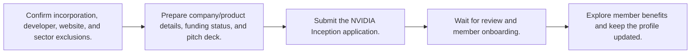

# 🌐 Global — Accelerators, Discounts, and Ecosystem Programs

Last reviewed: **2026-10-12**

Legend: ✅ Open · 🔄 Rolling · ⏳ Opens soon · ❌ Closed

## Apply-ready index

| Program | Provider | Official link | Type | Benefits | Eligibility | Deadline / status | Last verified |
|---|---|---|---|---|---|---|---|
| [NVIDIA Inception](#nvidia-inception) | NVIDIA | [Apply](https://www.nvidia.com/en-us/startups/) | Accelerator / discount | Free AI startup program with preferred pricing and partner offers | At least one developer; working website; incorporated; less than 10 years old. Excludes consulting/outsourcing, crypto-associated companies, cloud providers, resellers/distributors, and public companies. | 🔄 Rolling — no deadlines or cohorts | 2026-10-12 |

## Eligibility, benefits, and application roadmaps

<strong>🔄 Rolling NVIDIA Inception</strong> — NVIDIA

**Apply:** [https://www.nvidia.com/en-us/startups/](https://www.nvidia.com/en-us/startups/)  
**Last verified:** 2026-10-12

### Eligibility at a glance

| Requirement | Officially stated detail |
|---|---|
| Company stage | Any funding stage; incorporated AI/data startups. |
| Location / restrictions | Global; China applicants have a separate official contact listed in the FAQ. |
| Documents | Business/product details, incorporation date, funding status, and pitch deck. |
| Funding / revenue limits | Less than 10 years old; no revenue requirement; incorporation required. |
| Prerequisites | At least one developer, working website, and incorporation. |

### Benefits

- Free membership with no equity requirement.
- Developer tools and technical training.
- Preferred pricing on selected hardware/software.
- Partner cloud credits, investor-network exposure, and go-to-market resources.

### How to apply

1. Confirm incorporation, developer, website, and sector exclusions.
2. Prepare company/product details, funding status, and pitch deck.
3. Submit the NVIDIA Inception application.
4. Wait for review and member onboarding.
5. Explore member benefits and keep the profile updated.

**Estimated timeline:** No cohort deadline; review time not published.

