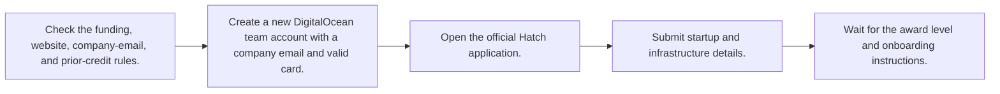
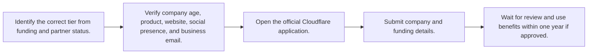
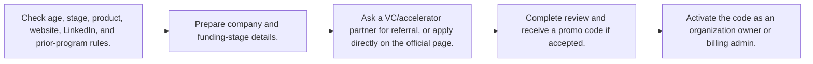
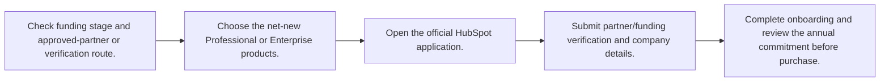
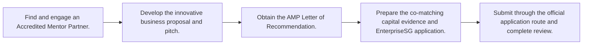
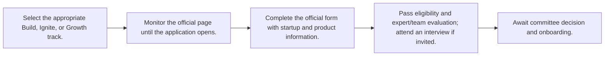

# 🌍 Global and Country Additions — New Programs

Last reviewed: **2026-10-12**

These entries are appended additions. They do not replace or rewrite the original category entries.

Legend: ✅ Open · 🔄 Rolling · ⏳ Opens soon · ❌ Closed

| Program | Provider | Region | Type | Benefits | Eligibility | Deadline / status | Apply | Last verified |
|---|---|---|---|---|---|---|---|---|
| [DigitalOcean Startups / Hatch](#digitalocean-startups) | DigitalOcean | Global | Credits / perks | 12 months of credits; award level set through the program | New startup; raised $10M or less; active company website; matching company email; registered DigitalOcean team account. | 🔄 Rolling — no 2026/2027 deadline published | [Apply](https://sammydigitalocean.typeform.com/hatch) | 2026-10-12 |
| [Cloudflare for Startups](#cloudflare-startups) | Cloudflare | Global | Credits / discount | $10,000–$350,000 credits for one year | Founded within 10 years; funded up to Series B; funded within the last 12 months for funded tiers; technology product; public website; public social presence; first-time applicant. | 🔄 Rolling — no 2026/2027 deadline published | [Apply](https://www.cloudflare.com/startups/) | 2026-10-12 |
| [MongoDB for Startups](#mongodb-startups) | MongoDB | Global | Credits / technical support | Atlas credits, Voyage AI tokens, technical expertise, and support | Base tier: less than 7 years old; Series A or earlier; scalable software product; active website and LinkedIn; new to the program. VC/accelerator referral is encouraged but non-VC applicants can apply on the page. | 🔄 Rolling — no 2026/2027 deadline published | [Apply](https://www.mongodb.com/solutions/startups) | 2026-10-12 |
| [HubSpot for Startups](#hubspot-startups) | HubSpot | Global | Discount | Up to 90% off in year one for eligible funded startups | Pre-seed, Seed, or Series A startups can qualify for 90% off year one when affiliated with an approved partner or with verified venture funding. Approved entrepreneurial organizations can qualify for 30% off year one. | 🔄 Rolling — application route currently available | [Apply](https://app.hubspot.com/signup-hubspot/hubspot-for-startups) | 2026-10-12 |
| [Startup SG Founder](#startup-sg-founder) | Enterprise Singapore | Singapore | Grant / mentorship | S$20,000–S$50,000 grant with 1:1 co-matching and mentorship | First-time entrepreneurs with innovative businesses; must work with an Accredited Mentor Partner and obtain a Letter of Recommendation before applying to EnterpriseSG. | 🔄 Rolling — no 2026/2027 deadline published on the official page | [Apply](https://www.startupsg.gov.sg/programmes/4894/startup-sg-founder/apply) | 2026-10-12 |
| [Start-Up Chile — Build / Ignite / Growth](#startup-chile) | CORFO / Start-Up Chile | Chile / Global founders | Accelerator / grant | Equity-free funding, coworking, mentorship, discounts, and network | Technology-based, innovative, scalable, high-impact businesses; program-specific stage criteria apply. The official application page currently says applications open soon. | ⏳ Opens soon — official page says applications open soon; no 2026/2027 deadline published | [Apply](https://startupchile.org/en/apply/) | 2026-10-12 |

## Detailed eligibility, benefits, and roadmaps

<strong>🔄 Rolling DigitalOcean Startups / Hatch</strong> — DigitalOcean

**Apply:** [https://sammydigitalocean.typeform.com/hatch](https://sammydigitalocean.typeform.com/hatch)  
**Official source:** [https://www.digitalocean.com/startups](https://www.digitalocean.com/startups)  
**Last verified:** 2026-10-12

### Eligibility at a glance

| Requirement | Officially stated detail |
|---|---|
| Company stage | Early-stage, with priority for AI-native startups. |
| Location / restrictions | Global; program availability and partner relationship are confirmed during application. |
| Documents | Company website, company-domain email, DigitalOcean team account, valid card, and startup details. |
| Funding / revenue limits | Raised $10M or less; no prior DigitalOcean startup credits; service businesses/agencies are not eligible. |
| Prerequisites | Create a new DigitalOcean team account before applying. |

### Benefits

- 12 months of DigitalOcean credits.
- Welcome Kit perks and technical/migration assistance.
- GPU credits may be separately reviewed; core credits exclude GPU products.

### How to apply

1. Check the funding, website, company-email, and prior-credit rules.
2. Create a new DigitalOcean team account with a company email and valid card.
3. Open the official Hatch application.
4. Submit startup and infrastructure details.
5. Wait for the award level and onboarding instructions.

**Estimated timeline:** Not published; credits are for 12 months and generally have a $10,000 monthly limit.

<strong>🔄 Rolling Cloudflare for Startups</strong> — Cloudflare

**Apply:** [https://www.cloudflare.com/startups/](https://www.cloudflare.com/startups/)  
**Official source:** [https://www.cloudflare.com/startups/](https://www.cloudflare.com/startups/)  
**Last verified:** 2026-10-12

### Eligibility at a glance

| Requirement | Officially stated detail |
|---|---|
| Company stage | Bootstrapped through Series B or later depending on tier. |
| Location / restrictions | Global; China Network is excluded from credit coverage. |
| Documents | Company website, domain-matching business email, public social profile, funding information, and product details. |
| Funding / revenue limits | Tier 3: bootstrapped or under $1M raised; Tier 2: under $5M raised and affiliated funding; Tier 1: $5M+ and affiliated funding. First-time applicants only. |
| Prerequisites | For-profit technology product and public online presence; not a consultancy, agency, MSP, reseller, educational institution, or personal blog. |

### Benefits

- $10,000 Tier 3 credits with no minimum funding.
- $100,000 Tier 2 credits.
- $350,000 Tier 1 maximum.
- Account management, expert sessions, support, and community access by tier.

### How to apply

1. Identify the correct tier from funding and partner status.
2. Verify company age, product, website, social presence, and business email.
3. Open the official Cloudflare application.
4. Submit company and funding details.
5. Wait for review and use benefits within one year if approved.

**Estimated timeline:** Credits are valid for one year or until consumed; review time not published.

<strong>🔄 Rolling MongoDB for Startups</strong> — MongoDB

**Apply:** [https://www.mongodb.com/solutions/startups](https://www.mongodb.com/solutions/startups)  
**Official source:** [https://www.mongodb.com/solutions/startups](https://www.mongodb.com/solutions/startups)  
**Last verified:** 2026-10-12

### Eligibility at a glance

| Requirement | Officially stated detail |
|---|---|
| Company stage | Bootstrapped through Series A for the published base tier; higher tiers vary. |
| Location / restrictions | Global application with country selection; program terms apply by jurisdiction. |
| Documents | Startup/company profile, website and LinkedIn, funding stage, country, and organization billing details for activation. |
| Funding / revenue limits | Base tier less than 7 years old and Series A or earlier; no revenue limit stated. |
| Prerequisites | New participant; software product; active website and LinkedIn; referral optional if not in a partner network. |

### Benefits

- Atlas credits.
- Voyage AI tokens/access.
- Technical expertise and dedicated support.
- Partner and go-to-market opportunities.

### How to apply

1. Check age, stage, product, website, LinkedIn, and prior-program rules.
2. Prepare company and funding-stage details.
3. Ask a VC/accelerator partner for referral, or apply directly on the official page.
4. Complete review and receive a promo code if accepted.
5. Activate the code as an organization owner or billing admin.

**Estimated timeline:** MongoDB asks applicants to contact them after five business days if no response; promo code can be activated within 12 months.

<strong>🔄 Rolling HubSpot for Startups</strong> — HubSpot

**Apply:** [https://app.hubspot.com/signup-hubspot/hubspot-for-startups](https://app.hubspot.com/signup-hubspot/hubspot-for-startups)  
**Official source:** [https://www.hubspot.com/startups](https://www.hubspot.com/startups)  
**Last verified:** 2026-10-12

### Eligibility at a glance

| Requirement | Officially stated detail |
|---|---|
| Company stage | Pre-seed through Series A for the highest published discount; organization-based tier also exists. |
| Location / restrictions | Global; eligibility is verified through HubSpot partners or funding databases. |
| Documents | Partner affiliation or verifiable funding; new Professional/Enterprise product selection; business account details. |
| Funding / revenue limits | 90% tier excludes Series B and later; discount applies to net-new Professional or Enterprise products; annual commitment required. |
| Prerequisites | Approved partner, verified venture funding, or approved entrepreneurial organization; net-new eligible products. |

### Benefits

- 90% off year one for eligible pre-seed/Seed/Series A startups.
- 50% off year two and 25% off year three for that tier.
- 30% off year one for approved entrepreneurial-organization tier and 15% off year two.
- Founder resources, training, and community.

### How to apply

1. Check funding stage and approved-partner or verification route.
2. Choose the net-new Professional or Enterprise products.
3. Open the official HubSpot application.
4. Submit partner/funding verification and company details.
5. Complete onboarding and review the annual commitment before purchase.

**Estimated timeline:** Not published; discount typically covers the initial two years before standard pricing.

<strong>🔄 Rolling Startup SG Founder</strong> — Enterprise Singapore

**Apply:** [https://www.startupsg.gov.sg/programmes/4894/startup-sg-founder/apply](https://www.startupsg.gov.sg/programmes/4894/startup-sg-founder/apply)  
**Official source:** [https://www.startupsg.gov.sg/programmes/4894/startup-sg-founder](https://www.startupsg.gov.sg/programmes/4894/startup-sg-founder)  
**Last verified:** 2026-10-12

### Eligibility at a glance

| Requirement | Officially stated detail |
|---|---|
| Company stage | First-time founders / early-stage innovative businesses. |
| Location / restrictions | Singapore scheme; paid-up capital and Singapore/ACRA requirements apply under the current scheme. |
| Documents | Letter of Recommendation, application materials, and evidence of co-matching capital; at least 50% must be paid-up capital in ACRA Bizfile at submission. |
| Funding / revenue limits | Grant quantum S$20,000–S$50,000 with 1:1 co-matching; no revenue cap stated on the overview page. |
| Prerequisites | Accredited Mentor Partner relationship and Letter of Recommendation. |

### Benefits

- S$20,000–S$50,000 startup grant.
- 1:1 mentorship and financial support.
- Pitch training, networking, and investor/corporate connections.
- Secretarial and accounting support.

### How to apply

1. Find and engage an Accredited Mentor Partner.
2. Develop the innovative business proposal and pitch.
3. Obtain the AMP Letter of Recommendation.
4. Prepare the co-matching capital evidence and EnterpriseSG application.
5. Submit through the official application route and complete review.

**Estimated timeline:** Not published; application must follow the AMP and EnterpriseSG process.

<strong>⏳ Opens soon Start-Up Chile — Build / Ignite / Growth</strong> — CORFO / Start-Up Chile

**Apply:** [https://startupchile.org/en/apply/](https://startupchile.org/en/apply/)  
**Official source:** [https://startupchile.org/en/apply/](https://startupchile.org/en/apply/)  
**Last verified:** 2026-10-12

### Eligibility at a glance

| Requirement | Officially stated detail |
|---|---|
| Company stage | Build: prototype to validated MVP; Ignite: growth-stage; Growth: expansion-stage, subject to current call rules. |
| Location / restrictions | Global founders can apply; selected founders may receive support processing a Chile work visa. |
| Documents | Application form, startup/product information, eligibility materials, and interview/pitch information if requested. |
| Funding / revenue limits | Funding and detailed limits vary by Build, Ignite, or Growth call; current official page does not publish a fixed amount in the active notice. |
| Prerequisites | Technology-based and scalable product; submit when the next call opens. |

### Benefits

- Equity-free funding.
- Free coworking space.
- Mentors, experts, board sessions, and pitch sessions.
- Investor/corporate/university network and Chile landing support.

### How to apply

1. Select the appropriate Build, Ignite, or Growth track.
2. Monitor the official page until the application opens.
3. Complete the official form with startup and product information.
4. Pass eligibility and expert/team evaluation; attend an interview if invited.
5. Await committee decision and onboarding.

**Estimated timeline:** Application page says applications open soon; review includes eligibility, expert/team evaluation, possible interview, and committee decision.

