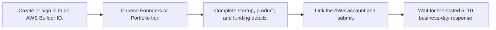
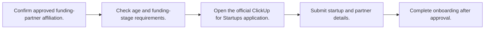
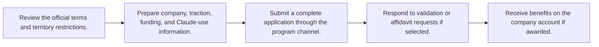
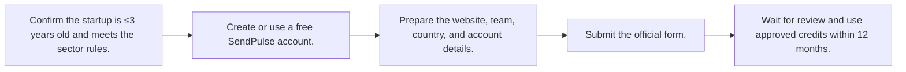
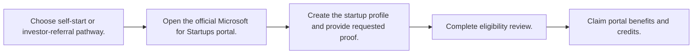
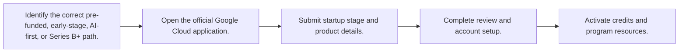
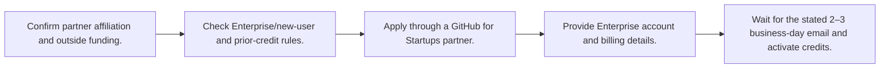

# 🌐 Global — Credits and Platform Benefits

Last reviewed: **2026-10-12**

Legend: ✅ Open · 🔄 Rolling · ⏳ Opens soon · ❌ Closed

## Apply-ready index

| Program | Provider | Official link | Type | Benefits | Eligibility | Deadline / status | Last verified |
|---|---|---|---|---|---|---|---|
| [AWS Activate Credits](#aws-activate) | Amazon Web Services | [Apply](https://aws.amazon.com/startups/credits/) | Credits | Up to $5,000 self-funded; up to $200,000 portfolio | Pre-Series B; founded ≤10 years; paid-tier AWS account; new to Activate or requesting more than previously received. Portfolio tier needs an Activate Provider Org ID. | 🔄 Rolling — no 2026/2027 deadline published | 2026-10-12 |
| [ClickUp for Startups](#clickup-startups) | ClickUp | [Apply](https://clickup.com/startup-program) | Credits / discount | $3,000 ClickUp credit plus Enterprise workspace | Approved funding-partner affiliation; no later than Series B; incorporated less than 5 years. | 🔄 Rolling — no 2026/2027 deadline published | 2026-10-12 |
| [Anthropic Startup Program](#anthropic-startup) | Anthropic | [Apply](https://www.anthropic.com/startup-program-official-terms) | Credits / ecosystem support | API credits, priority rate limits, and selected resources | Complete applications evaluated on traction, investment/funding, and Claude integration/usage; eligibility is at Anthropic’s discretion. | 🔄 Rolling — selections are made on a rolling basis | 2026-10-12 |
| [SendPulse Startup Grant](#sendpulse-grant) | SendPulse | [Apply](https://sendpulse.com/startup) | Grant / credits | $5,000 SendPulse credits valid for 12 months | Launched within 3 years; innovative product; not e-commerce/online business; no history of paid SendPulse plans. | 🔄 Rolling — applications reviewed within 1–3 business days | 2026-10-12 |
| [Microsoft for Startups](#microsoft-startups) | Microsoft | [Apply](https://www.microsoft.com/en/startups) | Credits / discount | Up to $150,000 credits plus AI and go-to-market support | Access is through the Microsoft for Startups portal; the official FAQ describes investor-referral and self-start pathways. Benefit tier is determined in the portal. | 🔄 Rolling — no 2026/2027 deadline published | 2026-10-12 |
| [Google for Startups Cloud Program](#google-cloud-startups) | Google Cloud | [Apply](https://cloud.google.com/startup) | Credits | $2,000 pre-funded; $200,000 Seed–A; up to $350,000 AI-first | Stage-based application: pre-funded, Seed–Series A, AI-first, or Series B+. Exact program rules are confirmed in the application flow. | 🔄 Rolling — applications presented as ongoing | 2026-10-12 |
| [GitHub for Startups](#github-startups) | GitHub | [Apply](https://github.com/enterprise/startups) | Credits / discount | $10,000 GitHub credits for up to 12 months | GitHub for Startups partner affiliation; outside funding up to Series B; new to GitHub Enterprise or absent for 6 months; no prior startup credits or Enterprise licenses. | 🔄 Rolling — approval described as ongoing | 2026-10-12 |

## Eligibility, benefits, and application roadmaps

<strong>🔄 Rolling AWS Activate Credits</strong> — Amazon Web Services

**Apply:** [https://aws.amazon.com/startups/credits/](https://aws.amazon.com/startups/credits/)  
**Last verified:** 2026-10-12

### Eligibility at a glance

| Requirement | Officially stated detail |
|---|---|
| Company stage | Pre-seed through pre-Series B. |
| Location / restrictions | Global, subject to AWS and applicable export/program restrictions. |
| Documents | Startup profile, product and funding-stage details, AWS account/Builder ID; Provider Org ID for Portfolio tier. |
| Funding / revenue limits | Founded within the last 10 years; no fixed revenue limit stated. |
| Prerequisites | Paid-tier AWS account; Portfolio requires an Activate Provider. |

### Benefits

- Up to $5,000 Activate Founders credits (starts at $1,000).
- Up to $200,000 Activate Portfolio credits.
- Additional AI credits may be invite-only.

### How to apply

1. Create or sign in to an AWS Builder ID.
2. Choose Founders or Portfolio tier.
3. Complete startup, product, and funding details.
4. Link the AWS account and submit.
5. Wait for the stated 5–10 business-day response.

**Estimated timeline:** AWS says applicants hear back within 5–10 business days.

<strong>🔄 Rolling ClickUp for Startups</strong> — ClickUp

**Apply:** [https://clickup.com/startup-program](https://clickup.com/startup-program)  
**Last verified:** 2026-10-12

### Eligibility at a glance

| Requirement | Officially stated detail |
|---|---|
| Company stage | Early-stage through Series B. |
| Location / restrictions | No geographic restriction stated on the official page. |
| Documents | Startup details and funding-partner affiliation; the official application determines additional fields. |
| Funding / revenue limits | Maximum Series B; incorporated <5 years. |
| Prerequisites | Approved funding partner. |

### Benefits

- $3,000 ClickUp credit.
- Enterprise workspace.
- Onboarding resources, training, and support.

### How to apply

1. Confirm approved funding-partner affiliation.
2. Check age and funding-stage requirements.
3. Open the official ClickUp for Startups application.
4. Submit startup and partner details.
5. Complete onboarding after approval.

**Estimated timeline:** Not published.

<strong>🔄 Rolling Anthropic Startup Program</strong> — Anthropic

**Apply:** [https://www.anthropic.com/startup-program-official-terms](https://www.anthropic.com/startup-program-official-terms)  
**Last verified:** 2026-10-12

### Eligibility at a glance

| Requirement | Officially stated detail |
|---|---|
| Company stage | Startup stage is not fixed in the published terms. |
| Location / restrictions | Not eligible if established/operating in or serving persons in Belarus, China, Cuba, Iran, Myanmar, North Korea, Russia, Sudan, Syria, Crimea, or the listed occupied regions; export controls also apply. |
| Documents | Complete application; company and contact details; information supporting evaluation. Selected applicants may need an affidavit/release within 14 days of request. |
| Funding / revenue limits | No fixed funding or revenue limit stated. |
| Prerequisites | Potential Claude integration/usage is an evaluation factor, not a guaranteed prerequisite. |

### Benefits

- Anthropic API credits.
- Priority rate limits.
- Access to selected Anthropic resources.

### How to apply

1. Review the official terms and territory restrictions.
2. Prepare company, traction, funding, and Claude-use information.
3. Submit a complete application through the program channel.
4. Respond to validation or affidavit requests if selected.
5. Receive benefits on the company account if awarded.

**Estimated timeline:** Rolling selection; selected applicants may have 14 calendar days to return requested documents.

<strong>🔄 Rolling SendPulse Startup Grant</strong> — SendPulse

**Apply:** [https://sendpulse.com/startup](https://sendpulse.com/startup)  
**Last verified:** 2026-10-12

### Eligibility at a glance

| Requirement | Officially stated detail |
|---|---|
| Company stage | Very early-stage startups, launched ≤3 years. |
| Location / restrictions | Country of registration is requested; no country exclusion stated on the page. |
| Documents | Startup name, website, applicant name, team size, country of registration, SendPulse account email, accelerator, and comment. |
| Funding / revenue limits | No paid-plan history; no fixed revenue limit stated. |
| Prerequisites | Free SendPulse account is allowed; paid-plan history disqualifies. |

### Benefits

- $5,000 bonus-balance credits.
- Valid for one year.
- Use across most tools, with official exclusions.

### How to apply

1. Confirm the startup is ≤3 years old and meets the sector rules.
2. Create or use a free SendPulse account.
3. Prepare the website, team, country, and account details.
4. Submit the official form.
5. Wait for review and use approved credits within 12 months.

**Estimated timeline:** Application review within 1–3 business days; credits last 12 months.

<strong>🔄 Rolling Microsoft for Startups</strong> — Microsoft

**Apply:** [https://www.microsoft.com/en/startups](https://www.microsoft.com/en/startups)  
**Last verified:** 2026-10-12

### Eligibility at a glance

| Requirement | Officially stated detail |
|---|---|
| Company stage | Founders and startups building on Azure; exact tier varies. |
| Location / restrictions | No global location restriction stated on the public page; portal rules apply. |
| Documents | Microsoft startup profile; investor referral code if using that path; Azure/Microsoft account details. |
| Funding / revenue limits | No fixed revenue or funding limit stated on the public page. |
| Prerequisites | Microsoft for Startups portal access; referral code may be used for the referral pathway. |

### Benefits

- Up to $150,000 credits.
- AI services and developer tools.
- Technical guidance and enterprise go-to-market support.

### How to apply

1. Choose self-start or investor-referral pathway.
2. Open the official Microsoft for Startups portal.
3. Create the startup profile and provide requested proof.
4. Complete eligibility review.
5. Claim portal benefits and credits.

**Estimated timeline:** Not published.

<strong>🔄 Rolling Google for Startups Cloud Program</strong> — Google Cloud

**Apply:** [https://cloud.google.com/startup](https://cloud.google.com/startup)  
**Last verified:** 2026-10-12

### Eligibility at a glance

| Requirement | Officially stated detail |
|---|---|
| Company stage | Pre-funded through Series B+. |
| Location / restrictions | No country restriction stated on the public page; program availability may vary by region. |
| Documents | Startup and funding-stage profile; cloud/account details requested through the application. |
| Funding / revenue limits | Funding stage determines tier; no revenue limit stated. |
| Prerequisites | Google Cloud application and account. |

### Benefits

- $2,000 for pre-funded MVPs.
- $200,000 for Seed–Series A.
- Up to $350,000 for AI-first startups.
- Customized support for Series B+.

### How to apply

1. Identify the correct pre-funded, early-stage, AI-first, or Series B+ path.
2. Open the official Google Cloud application.
3. Submit startup stage and product details.
4. Complete review and account setup.
5. Activate credits and program resources.

**Estimated timeline:** Not published.

<strong>🔄 Rolling GitHub for Startups</strong> — GitHub

**Apply:** [https://github.com/enterprise/startups](https://github.com/enterprise/startups)  
**Last verified:** 2026-10-12

### Eligibility at a glance

| Requirement | Officially stated detail |
|---|---|
| Company stage | Early-stage through Series B. |
| Location / restrictions | GitHub Enterprise Cloud on GitHub.com only; no Enterprise Server or Data Residency accounts. |
| Documents | Partner affiliation, outside-funding evidence, Enterprise account, valid payment method, and company details. |
| Funding / revenue limits | Outside funding up to Series B; no prior offer; credits expire after 12 months or consumption. |
| Prerequisites | Approved GitHub partner and outside funding; new/returning Enterprise status. |

### Benefits

- $10,000 credits.
- Up to 12 months.
- Enterprise, Copilot, Advanced Security, Actions, and other eligible metered offerings.

### How to apply

1. Confirm partner affiliation and outside funding.
2. Check Enterprise/new-user and prior-credit rules.
3. Apply through a GitHub for Startups partner.
4. Provide Enterprise account and billing details.
5. Wait for the stated 2–3 business-day email and activate credits.

**Estimated timeline:** GitHub says applicants receive an email within 2–3 business days.

