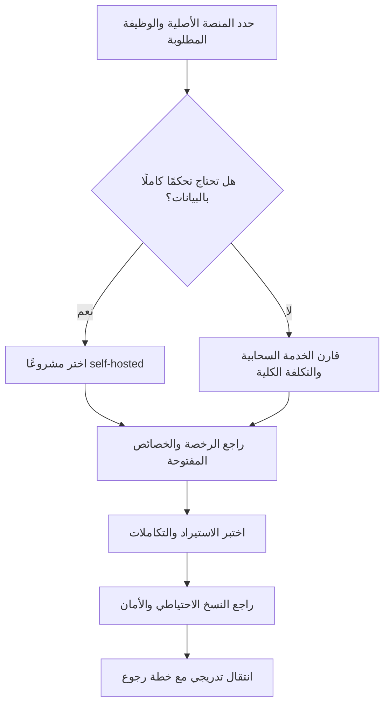

# بدائل مفتوحة المصدر لأدوات الشركات الناشئة

يجمع هذا القسم بدائل مفتوحة المصدر وOpen-core وSource-available للأدوات التي تستخدمها الشركات الناشئة في إدارة البيانات، والتسويق، والبريد، والأتمتة، وCRM، والدعم، وإدارة المشاريع، والنماذج، والاستطلاعات، والتحليلات.

> **الاستشارات والموارد المدفوعة:** اشترك في [قناة WhatsApp](https://whatsapp.com/channel/0029VbDooCVB4hdLbJFCgW0L) للوصول إلى الاستشارات والموارد المدفوعة المختارة والمبنية على هذا الدليل.

> **ملاحظة حول النطاق:** المقصود بعبارة «منصات التمويل» هنا منصات التشغيل والنمو التي تدفع الشركات الناشئة مقابل استخدامها، مثل Airtable وSendPulse وZapier، وليس منصات جمع الاستثمار أو التمويل الجماعي. يمكن إضافة قسم مستقل لمنصات التمويل الجماعي لاحقًا.

## كيفية قراءة الجدول

- **Open source:** يذكر المستودع الرسمي رخصة واضحة مفتوحة المصدر.
- **Open-core:** النواة الأساسية مفتوحة المصدر، بينما قد تكون الخصائص الإضافية تجارية.
- **Source-available / Fair-code:** الشيفرة متاحة، لكن الرخصة قد لا تكون رخصة مفتوحة المصدر معتمدة أو قد تتضمن قيودًا على الاستخدام التجاري. راجع الرخصة قبل إعادة التوزيع أو تقديم خدمة مستضافة.
- **Self-hosted:** يمكن تشغيل المشروع على بنيتك التحتية، لكن ذلك لا يعني انعدام التكلفة؛ فأنت مسؤول عن البريد والنسخ الاحتياطي والتحديثات والأمان والمراقبة والامتثال.

## اختيارات سريعة حسب المنصة الأصلية

| إذا كنت تستخدم | ابدأ بـ | لماذا |
|---|---|---|
| Airtable | [Baserow](#baserow) أو [Grist](#grist) أو [NocoDB](#nocodb) | قواعد بيانات بواجهة جدولية مع إمكانية الاستضافة الذاتية؛ راجع اختلافات الرخصة. |
| SendPulse / Mailchimp | [Mautic](#mautic) أو [listmonk](#listmonk) | Mautic للأتمتة متعددة القنوات، وlistmonk للنشرات والقوائم البريدية. |
| SendGrid / Mailgun | [Postal](#postal) | منصة تسليم بريد مستضافة ذاتيًا؛ تحتاج إلى إعداد DNS وتشغيل السمعة البريدية. |
| Zapier / Make | [Activepieces](#activepieces) أو [Node-RED](#node-red) | أتمتة مرئية وتكاملات؛ Activepieces أقرب إلى no-code، وNode-RED أقرب إلى التدفقات الحدثية. |
| n8n | [Windmill](#windmill) أو [Activepieces](#activepieces) | كلاهما قابل للاستضافة الذاتية؛ n8n مصنف هنا Fair-code وليس Open Source بالمعنى الصارم. |
| Salesforce / HubSpot CRM | [Twenty](#twenty) أو [EspoCRM](#espocrm) أو [SuiteCRM](#suitecrm) | خيارات CRM قابلة للتخصيص والاستضافة الذاتية. |
| Intercom / Zendesk | [Chatwoot](#chatwoot) أو [Zammad](#zammad) | صندوق دعم متعدد القنوات أو helpdesk متكامل. |
| Jira / Linear / ClickUp | [Plane](#plane) أو [OpenProject](#openproject) | إدارة مشاريع ومهام وخرائط طريق مع استضافة ذاتية. |
| Typeform / Qualtrics | [Formbricks](#formbricks) أو [LimeSurvey](#limesurvey) | استطلاعات ونماذج وجمع ملاحظات العملاء. |
| Google Analytics | [Plausible](#plausible) | تحليلات ويب خفيفة وتركز على الخصوصية وقابلة للاستضافة الذاتية. |

## الدليل الموحد

البيانات القابلة للبحث موجودة في [alternatives.csv](alternatives.csv) (النسخة الإنجليزية) و[alternatives.ar.csv](alternatives.ar.csv) (النسخة العربية). يحتوي كل صف على المنصة الأصلية، والبديل، والفئة، ونموذج الرخصة، والاستضافة، والوظائف، والموقع الرسمي، ومستودع المصدر، وتاريخ التحقق.

| البديل | بديل عن | الفئة | نموذج المصدر / الترخيص | الاستضافة | نقاط القوة | الموقع الرسمي | المستودع الرسمي | آخر تحقق |
|---|---|---|---|---|---|---|---|---|
| [Baserow](https://baserow.io/) | Airtable | قاعدة بيانات no-code | Open-core؛ MIT للخصائص غير التجارية/المؤسسية حسب المستودع | نعم | جداول، تطبيقات، أتمتة، API، لوحات | [baserow.io](https://baserow.io/) | [GitHub](https://github.com/baserow/baserow) | 2026-10-13 |
| [NocoDB](https://nocodb.com/) | Airtable | قاعدة بيانات no-code | Source-available؛ Sustainable Use License | نعم | يحول قواعد SQL إلى واجهة شبيهة بالجداول، عروض، أدوار، REST API وتكاملات | [nocodb.com](https://nocodb.com/) | [GitHub](https://github.com/nocodb/nocodb) | 2026-10-13 |
| [Grist](https://www.getgrist.com/) | Airtable / Google Sheets | جدول علائقي | Apache-2.0 للنواة المفتوحة | نعم | جداول علائقية، صيغ Python، نماذج، لوحات، صلاحيات | [getgrist.com](https://www.getgrist.com/) | [GitHub](https://github.com/gristlabs/grist-core) | 2026-10-13 |
| [Mautic](https://www.mautic.org/) | SendPulse / Mailchimp / HubSpot Marketing | تسويق آلي | Open source؛ رخصة المشروع موثقة في المستودع | نعم | حملات، تقسيم، أتمتة متعددة القنوات، تخصيص كامل | [mautic.org](https://www.mautic.org/) | [GitHub](https://github.com/mautic/mautic) | 2026-10-13 |
| [listmonk](https://listmonk.app/) | SendPulse / Mailchimp | نشرات وقوائم بريدية | AGPL-3.0 | نعم | مدير نشرات سريع، قوائم، حملات، تطبيق ثنائي واحد | [listmonk.app](https://listmonk.app/) | [GitHub](https://github.com/knadh/listmonk) | 2026-10-13 |
| [Postal](https://docs.postalserver.io/) | SendGrid / Mailgun / Postmark | تسليم البريد | MIT | نعم | بريد وارد وصادر، منصة تسليم كاملة للمواقع والخوادم | [docs.postalserver.io](https://docs.postalserver.io/) | [GitHub](https://github.com/postalserver/postal) | 2026-10-13 |
| [n8n](https://n8n.io/) | Zapier / Make | أتمتة وسير عمل | Source-available / Fair-code؛ Sustainable Use License | نعم | لوحة مرئية، شيفرة مخصصة، تكاملات كثيرة، AI workflows | [n8n.io](https://n8n.io/) | [GitHub](https://github.com/n8n-io/n8n) | 2026-10-13 |
| [Activepieces](https://activepieces.com/) | Zapier / Make / n8n | أتمتة no-code | MIT لإصدار Community؛ خصائص Enterprise برخصة تجارية | نعم | تدفقات مرئية، pieces قابلة للتوسعة، MCP، تكاملات | [activepieces.com](https://activepieces.com/) | [GitHub](https://github.com/activepieces/activepieces) | 2026-10-13 |
| [Windmill](https://www.windmill.dev/) | Retool / Pipedream / Temporal | أتمتة للمطورين | AGPL-3.0 | نعم | تحويل Python/TypeScript/Go/Bash إلى APIs وواجهات وتدفقات | [windmill.dev](https://www.windmill.dev/) | [GitHub](https://github.com/windmill-labs/windmill) | 2026-10-13 |
| [Node-RED](https://nodered.org/) | Zapier / أتمتة الأحداث | أتمتة حدثية وlow-code | Apache-2.0 | نعم | تدفقات حدثية، أجهزة وإنترنت الأشياء، عقد وتكاملات | [nodered.org](https://nodered.org/) | [GitHub](https://github.com/node-red/node-red) | 2026-10-13 |
| [Twenty](https://twenty.com/) | Salesforce / HubSpot CRM | CRM | Open source؛ راجع LICENSE للنسخة والخصائص الحالية | نعم | كائنات وحقول وواجهات CRM قابلة للتوسعة ككود | [twenty.com](https://twenty.com/) | [GitHub](https://github.com/twentyhq/twenty) | 2026-10-13 |
| [SuiteCRM](https://suitecrm.com/) | Salesforce / SugarCRM | CRM | AGPL-3.0 | نعم | CRM مؤسسي ناضج، حملات، مبيعات، دعم وتخصيص | [suitecrm.com](https://suitecrm.com/) | [GitHub](https://github.com/SuiteCRM/SuiteCRM) | 2026-10-13 |
| [EspoCRM](https://www.espocrm.com/) | Salesforce / HubSpot CRM | CRM | AGPL-3.0 | نعم | جهات اتصال، فرص، حملات، حالات دعم، REST API | [espocrm.com](https://www.espocrm.com/) | [GitHub](https://github.com/espocrm/espocrm) | 2026-10-13 |
| [Chatwoot](https://www.chatwoot.com/) | Intercom / Zendesk / Salesforce Service Cloud | دعم متعدد القنوات | Open source؛ تحقق من LICENSE للخصائص المؤسسية | نعم | دردشة، بريد، WhatsApp، Telegram، مركز مساعدة، أتمتة | [chatwoot.com](https://www.chatwoot.com/) | [GitHub](https://github.com/chatwoot/chatwoot) | 2026-10-13 |
| [Zammad](https://zammad.org/) | Zendesk / Freshdesk | Helpdesk | AGPL-3.0 | نعم | تذاكر ودعم عبر البريد والدردشة والهاتف والقنوات الاجتماعية | [zammad.org](https://zammad.org/) | [GitHub](https://github.com/zammad/zammad) | 2026-10-13 |
| [Plane](https://plane.so/) | Jira / Linear / Monday / ClickUp | إدارة مشاريع | AGPL-3.0 | نعم | مهام، دورات، وحدات، صفحات، تحليلات وخرائط طريق | [plane.so](https://plane.so/) | [GitHub](https://github.com/makeplane/plane) | 2026-10-13 |
| [OpenProject](https://www.openproject.org/) | Jira / MS Project / Monday / Asana | إدارة مشاريع ومحافظ | GPL-3.0 | نعم | Agile، Kanban، Gantt، محافظ، ميزانيات، وقت وتعاون | [openproject.org](https://www.openproject.org/) | [GitHub](https://github.com/opf/openproject) | 2026-10-13 |
| [Formbricks](https://formbricks.com/) | Qualtrics / Typeform | استطلاعات وملاحظات | AGPLv3 للنواة؛ خصائص Enterprise برخصة تجارية | نعم | استطلاعات داخل التطبيق والويب والرابط والبريد، وتحليل ملاحظات | [formbricks.com](https://formbricks.com/) | [GitHub](https://github.com/formbricks/formbricks) | 2026-10-13 |
| [LimeSurvey](https://www.limesurvey.org/) | SurveyMonkey / Typeform / Qualtrics | نماذج واستطلاعات | GPL-2.0 أو أحدث | نعم | منطق شرطي، تفرعات، لغات متعددة، API وخصوصية | [limesurvey.org](https://www.limesurvey.org/) | [GitHub](https://github.com/LimeSurvey/LimeSurvey) | 2026-10-13 |
| [Plausible](https://plausible.io/) | Google Analytics | تحليلات ويب | AGPLv3 للنسخة المجتمعية | نعم | تحليلات خفيفة بلا cookies، خصوصية، أهداف، مسارات وAPI | [plausible.io](https://plausible.io/) | [GitHub](https://github.com/plausible/analytics) | 2026-10-13 |

## ملاحظات تشغيلية قبل الاستبدال

1. **راجع الرخصة قبل الاستخدام التجاري.** لا تمنح مشاريع Open-core وSource-available نفس حريات مشاريع MIT وApache وGPL في كل المكونات.
2. **قارن الوظائف لا الأسماء فقط.** تتشابه Baserow وGrist وNocoDB ظاهريًا، لكن نماذج البيانات والصلاحيات والرخص تختلف.
3. **البريد ليس تطبيقًا فقط.** عند استبدال SendPulse تحتاج إلى مزود SMTP أو خادم تسليم مثل Postal، إضافة إلى SPF وDKIM وDMARC وإدارة السمعة والتعامل مع الارتدادات.
4. **الاستضافة الذاتية مسؤولية تشغيلية.** حدّث الصور، وراقب الثغرات، وفعّل النسخ الاحتياطي، واختبر الاستعادة، واحفظ الأسرار خارج المستودع.
5. **لا تخلط بين البرنامج وخدمة SaaS المدارة.** قد تكون الشيفرة مفتوحة بينما تكون بعض وظائف السحابة أو المؤسسة مدفوعة.

## خريطة اختيار البديل

## المصادر الرسمية

المصدر الأساسي لكل صف هو الموقع الرسمي ومستودع المشروع الرسمي المرتبطان مباشرة في الجدول. تم التحقق من توفر المواقع وبيانات الرخصة ووصف الوظائف في **2026-10-13**. وجود المشروع في هذا الدليل لا يمثل ضمانًا للأمان أو الملاءمة أو الدعم التجاري.

[العربية](README.ar.md) · [English](README.md)
