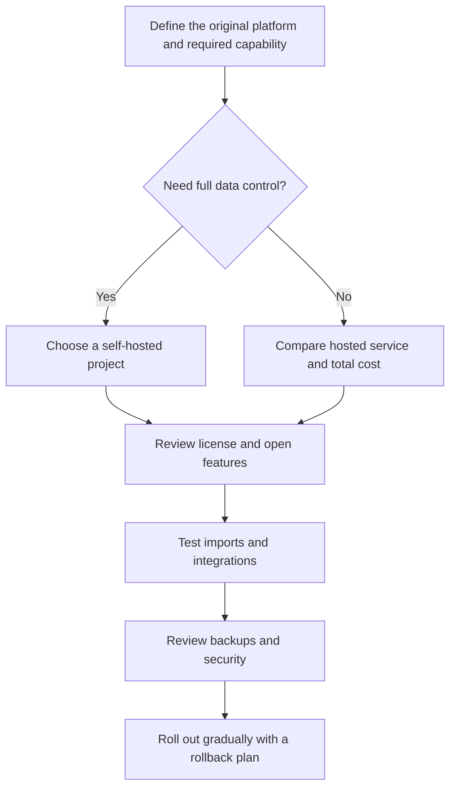

# Open Source Alternatives for Startup SaaS

This section catalogs open-source, open-core, and source-available alternatives to tools startups use for data management, marketing, email, automation, CRM, support, project management, forms, surveys, and analytics.

> **Paid consultation and resources:** Subscribe to the [WhatsApp channel](https://whatsapp.com/channel/0029VbDooCVB4hdLbJFCgW0L) for consultation access and selected paid resources based on this directory.

> **Scope note:** “Funding platforms” is interpreted here as the operating and growth platforms startups pay for, such as Airtable, SendPulse, and Zapier—not investment-raising or crowdfunding platforms. A separate crowdfunding section can be added later.

## How to read the table

- **Open source:** the official repository identifies a clear open-source license.
- **Open-core:** the core is open source, while additional features may be commercial.
- **Source-available / Fair-code:** the source is visible, but the license may not be an OSI-approved open-source license or may include commercial-use restrictions. Review the license before redistribution or offering a hosted service.
- **Self-hosted:** the project can run on your infrastructure. This does not mean zero cost; you remain responsible for email delivery, backups, updates, security, monitoring, and compliance.

## Quick picks by original platform

| If you use | Start with | Why |
|---|---|---|
| Airtable | [Baserow](#baserow), [Grist](#grist), or [NocoDB](#nocodb) | Table-style databases with self-hosting; review license differences. |
| SendPulse / Mailchimp | [Mautic](#mautic) or [listmonk](#listmonk) | Mautic for multichannel automation; listmonk for newsletters and mailing lists. |
| SendGrid / Mailgun | [Postal](#postal) | Self-hosted mail delivery; requires DNS and deliverability operations. |
| Zapier / Make | [Activepieces](#activepieces) or [Node-RED](#node-red) | Visual automation and integrations; Activepieces is closer to no-code, Node-RED to event-driven flows. |
| n8n | [Windmill](#windmill) or [Activepieces](#activepieces) | Both are self-hostable; n8n itself is labeled Fair-code here, not strict OSI open source. |
| Salesforce / HubSpot CRM | [Twenty](#twenty), [EspoCRM](#espocrm), or [SuiteCRM](#suitecrm) | Customizable, self-hostable CRM options. |
| Intercom / Zendesk | [Chatwoot](#chatwoot) or [Zammad](#zammad) | Omnichannel support inbox or full helpdesk. |
| Jira / Linear / ClickUp | [Plane](#plane) or [OpenProject](#openproject) | Self-hosted project, task, and roadmap management. |
| Typeform / Qualtrics | [Formbricks](#formbricks) or [LimeSurvey](#limesurvey) | Surveys, forms, and customer feedback collection. |
| Google Analytics | [Plausible](#plausible) | Lightweight, privacy-first, self-hostable web analytics. |

## Unified directory

The searchable datasets are available in [alternatives.csv](alternatives.csv) and [alternatives.ar.csv](alternatives.ar.csv). Each row contains the original platform, alternative, category, license model, hosting, capabilities, official website, official repository, and verification date.

| Alternative | Alternative to | Category | Source model / license | Self-hosted | Key capabilities | Official site | Official repository | Last verified |
|---|---|---|---|---|---|---|---|---|
| [Baserow](https://baserow.io/) | Airtable | No-code database | Open-core; MIT for non-premium/non-enterprise features according to the repository | Yes | Tables, applications, automations, API, dashboards | [baserow.io](https://baserow.io/) | [GitHub](https://github.com/baserow/baserow) | 2026-10-13 |
| [NocoDB](https://nocodb.com/) | Airtable | No-code database | Source-available; Sustainable Use License | Yes | SQL-to-spreadsheet interface, views, roles, REST API, integrations | [nocodb.com](https://nocodb.com/) | [GitHub](https://github.com/nocodb/nocodb) | 2026-10-13 |
| [Grist](https://www.getgrist.com/) | Airtable / Google Sheets | Relational spreadsheet | Apache-2.0 for the open core | Yes | Relational spreadsheets, Python formulas, forms, dashboards, access rules | [getgrist.com](https://www.getgrist.com/) | [GitHub](https://github.com/gristlabs/grist-core) | 2026-10-13 |
| [Mautic](https://www.mautic.org/) | SendPulse / Mailchimp / HubSpot Marketing | Marketing automation | Open source; project license is documented in the repository | Yes | Campaigns, segmentation, multichannel automation, full customization | [mautic.org](https://www.mautic.org/) | [GitHub](https://github.com/mautic/mautic) | 2026-10-13 |
| [listmonk](https://listmonk.app/) | SendPulse / Mailchimp | Newsletters and mailing lists | AGPL-3.0 | Yes | Fast newsletter manager, lists, campaigns, single binary | [listmonk.app](https://listmonk.app/) | [GitHub](https://github.com/knadh/listmonk) | 2026-10-13 |
| [Postal](https://docs.postalserver.io/) | SendGrid / Mailgun / Postmark | Email delivery | MIT | Yes | Incoming and outgoing mail delivery for websites and servers | [docs.postalserver.io](https://docs.postalserver.io/) | [GitHub](https://github.com/postalserver/postal) | 2026-10-13 |
| [n8n](https://n8n.io/) | Zapier / Make | Workflow automation | Source-available / Fair-code; Sustainable Use License | Yes | Visual workflows, custom code, many integrations, AI workflows | [n8n.io](https://n8n.io/) | [GitHub](https://github.com/n8n-io/n8n) | 2026-10-13 |
| [Activepieces](https://activepieces.com/) | Zapier / Make / n8n | No-code automation | MIT for Community Edition; Enterprise features use a commercial license | Yes | Visual flows, extensible pieces, MCP, integrations | [activepieces.com](https://activepieces.com/) | [GitHub](https://github.com/activepieces/activepieces) | 2026-10-13 |
| [Windmill](https://www.windmill.dev/) | Retool / Pipedream / Temporal | Developer automation | AGPL-3.0 | Yes | Python/TypeScript/Go/Bash to APIs, UIs, jobs, and workflows | [windmill.dev](https://www.windmill.dev/) | [GitHub](https://github.com/windmill-labs/windmill) | 2026-10-13 |
| [Node-RED](https://nodered.org/) | Zapier / event automation | Event-driven low-code | Apache-2.0 | Yes | Event-driven flows, IoT, nodes, and integrations | [nodered.org](https://nodered.org/) | [GitHub](https://github.com/node-red/node-red) | 2026-10-13 |
| [Twenty](https://twenty.com/) | Salesforce / HubSpot CRM | CRM | Open source; review LICENSE for the current edition and features | Yes | Custom CRM objects, fields, views, workflows, apps, and agents | [twenty.com](https://twenty.com/) | [GitHub](https://github.com/twentyhq/twenty) | 2026-10-13 |
| [SuiteCRM](https://suitecrm.com/) | Salesforce / SugarCRM | CRM | AGPL-3.0 | Yes | Mature enterprise CRM, campaigns, sales, support, customization | [suitecrm.com](https://suitecrm.com/) | [GitHub](https://github.com/SuiteCRM/SuiteCRM) | 2026-10-13 |
| [EspoCRM](https://www.espocrm.com/) | Salesforce / HubSpot CRM | CRM | AGPL-3.0 | Yes | Leads, contacts, opportunities, campaigns, cases, REST API | [espocrm.com](https://www.espocrm.com/) | [GitHub](https://github.com/espocrm/espocrm) | 2026-10-13 |
| [Chatwoot](https://www.chatwoot.com/) | Intercom / Zendesk / Salesforce Service Cloud | Omnichannel support | Open source; review LICENSE for enterprise features | Yes | Chat, email, WhatsApp, Telegram, help center, automation | [chatwoot.com](https://www.chatwoot.com/) | [GitHub](https://github.com/chatwoot/chatwoot) | 2026-10-13 |
| [Zammad](https://zammad.org/) | Zendesk / Freshdesk | Helpdesk | AGPL-3.0 | Yes | Tickets and support through email, chat, telephone, and social channels | [zammad.org](https://zammad.org/) | [GitHub](https://github.com/zammad/zammad) | 2026-10-13 |
| [Plane](https://plane.so/) | Jira / Linear / Monday / ClickUp | Project management | AGPL-3.0 | Yes | Work items, cycles, modules, pages, analytics, roadmaps | [plane.so](https://plane.so/) | [GitHub](https://github.com/makeplane/plane) | 2026-10-13 |
| [OpenProject](https://www.openproject.org/) | Jira / MS Project / Monday / Asana | Project and portfolio management | GPL-3.0 | Yes | Agile, Kanban, Gantt, portfolios, budgets, time, collaboration | [openproject.org](https://www.openproject.org/) | [GitHub](https://github.com/opf/openproject) | 2026-10-13 |
| [Formbricks](https://formbricks.com/) | Qualtrics / Typeform | Surveys and feedback | AGPLv3 core; Enterprise features use a commercial license | Yes | In-app, website, link, and email surveys; feedback insights | [formbricks.com](https://formbricks.com/) | [GitHub](https://github.com/formbricks/formbricks) | 2026-10-13 |
| [LimeSurvey](https://www.limesurvey.org/) | SurveyMonkey / Typeform / Qualtrics | Forms and surveys | GPL-2.0 or later | Yes | Conditional logic, branching, multilingual surveys, API, privacy | [limesurvey.org](https://www.limesurvey.org/) | [GitHub](https://github.com/LimeSurvey/LimeSurvey) | 2026-10-13 |
| [Plausible](https://plausible.io/) | Google Analytics | Web analytics | AGPLv3 for the Community Edition | Yes | Lightweight cookie-free analytics, privacy, goals, funnels, API | [plausible.io](https://plausible.io/) | [GitHub](https://github.com/plausible/analytics) | 2026-10-13 |

## Operational notes before switching

1. **Review the license before commercial use.** Open-core and source-available projects do not provide the same freedoms in every component as MIT, Apache, or GPL projects.
2. **Compare capabilities, not names.** Baserow, Grist, and NocoDB look similar but differ in data models, permissions, and licensing.
3. **Email is more than an application.** Replacing SendPulse requires an SMTP provider or delivery server such as Postal, plus SPF, DKIM, DMARC, reputation management, and bounce handling.
4. **Self-hosting is an operational responsibility.** Update images, monitor vulnerabilities, enable backups, test restores, and keep secrets outside the repository.
5. **Do not confuse software with managed SaaS.** The code may be open while cloud or enterprise functionality is paid.

## Selection roadmap

## Official sources

The primary source for every row is the official website and official repository linked directly in the table. Website availability, license statements, and capability descriptions were checked on **2026-10-13**. Inclusion in this directory is not a security, suitability, or commercial-support guarantee.

[العربية](README.ar.md) · [English](README.md)
