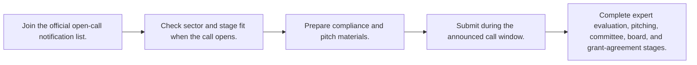
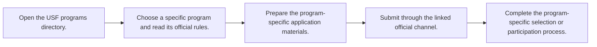
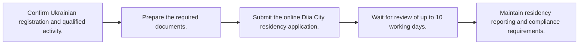

# 🇺🇦 Ukraine — Grants and Startup Ecosystem Programs

Last reviewed: **2026-10-12**

Legend: ✅ Open · 🔄 Rolling · ⏳ Opens soon · ❌ Closed

## Apply-ready index

| Program | Provider | Official link | Type | Benefits | Eligibility | Deadline / status | Last verified |
|---|---|---|---|---|---|---|---|
| [Startup EDGE](#startup-edge) | Ukrainian Startup Fund | [Apply](https://usf.com.ua/en/programs/startup-edge) | Grant | Up to €20,000 pre-seed; up to €40,000 seed | Innovative Ukrainian early-stage startups in Deep Tech, Green Tech, or EdTech; formal compliance, expert evaluation, pitching, committee, board, and agreement stages. | ⏳ Opens soon — official page says call for applications coming soon | 2026-10-12 |
| [Ukrainian Startup Fund — ecosystem programs](#usf-ecosystem) | Ukrainian Startup Fund | [Apply](https://usf.com.ua/en/) | Grant / accelerator / ecosystem support | Startup EDGE, AI & Blockchain Sandbox, schools, missions, and other programs | Varies by program; each linked program page has its own rules, sectors, and call status. | 🔄 Rolling — program-specific dates | 2026-10-12 |
| [Diia City residency](#diia-city) | Ministry of Digital Transformation of Ukraine / Diia City | [Apply](https://city.diia.gov.ua/en/) | Discount / legal and tax framework | Preferential tax, GIG contracts, IP protections, and investment tools | Company registered under Ukrainian law; qualified IT/innovation activities; residency conditions and required documents must be met. | 🔄 Rolling — no annual deadline; online applications | 2026-10-12 |

## Eligibility, benefits, and application roadmaps

<strong>⏳ Opens soon Startup EDGE</strong> — Ukrainian Startup Fund

**Apply:** [https://usf.com.ua/en/programs/startup-edge](https://usf.com.ua/en/programs/startup-edge)  
**Last verified:** 2026-10-12

### Eligibility at a glance

| Requirement | Officially stated detail |
|---|---|
| Company stage | Pre-seed and seed. |
| Location / restrictions | Ukraine-focused program; official page describes strengthening Ukraine’s ecosystem. |
| Documents | Eligibility/compliance materials, pitch materials, and grant-agreement information requested during the call. |
| Funding / revenue limits | Stage-based grant caps; no revenue limit stated. |
| Prerequisites | Fit one of the three focus sectors and pass staged review. |

### Benefits

- Up to €20,000 pre-seed grant.
- Up to €40,000 seed grant.
- Focus on Deep Tech, Green Tech, and EdTech.

### How to apply

1. Join the official open-call notification list.
2. Check sector and stage fit when the call opens.
3. Prepare compliance and pitch materials.
4. Submit during the announced call window.
5. Complete expert evaluation, pitching, committee, board, and grant-agreement stages.

**Estimated timeline:** Application deadline not yet published.

<strong>🔄 Rolling Ukrainian Startup Fund — ecosystem programs</strong> — Ukrainian Startup Fund

**Apply:** [https://usf.com.ua/en/](https://usf.com.ua/en/)  
**Last verified:** 2026-10-12

### Eligibility at a glance

| Requirement | Officially stated detail |
|---|---|
| Company stage | Varies by program. |
| Location / restrictions | Ukraine-focused ecosystem; program pages specify any international component. |
| Documents | Varies by program; use the specific official program page. |
| Funding / revenue limits | Varies by program; no fund-wide limit. |
| Prerequisites | Program-specific. |

### Benefits

- Grant and non-financial support opportunities.
- AI & Blockchain Sandbox.
- Tech missions and startup schools.
- Seeds of Bravery and corporate innovation programs.

### How to apply

1. Open the USF programs directory.
2. Choose a specific program and read its official rules.
3. Prepare the program-specific application materials.
4. Submit through the linked official channel.
5. Complete the program-specific selection or participation process.

**Estimated timeline:** Program-specific.

<strong>🔄 Rolling Diia City residency</strong> — Ministry of Digital Transformation of Ukraine / Diia City

**Apply:** [https://city.diia.gov.ua/en/](https://city.diia.gov.ua/en/)  
**Last verified:** 2026-10-12

### Eligibility at a glance

| Requirement | Officially stated detail |
|---|---|
| Company stage | Ukrainian technology and innovation companies. |
| Location / restrictions | Ukraine-only: company must be registered under Ukrainian law. |
| Documents | Required company documents and online residency application; compliance report and independent opinion are required for reporting. |
| Funding / revenue limits | Must satisfy Diia City residency conditions; no startup revenue cap stated on the public page. |
| Prerequisites | Ukrainian registration and qualified activity; online application. |

### Benefits

- 5% personal income tax, 22% minimum-wage social contribution, and 5% military levy for employment taxes.
- 9% distributed-profit or 18% profit-tax model.
- GIG contracts, IP protections, and venture-investment instruments.

### How to apply

1. Confirm Ukrainian registration and qualified activity.
2. Prepare the required documents.
3. Submit the online Diia City residency application.
4. Wait for review of up to 10 working days.
5. Maintain residency reporting and compliance requirements.

**Estimated timeline:** Official page says application review takes up to 10 working days.

